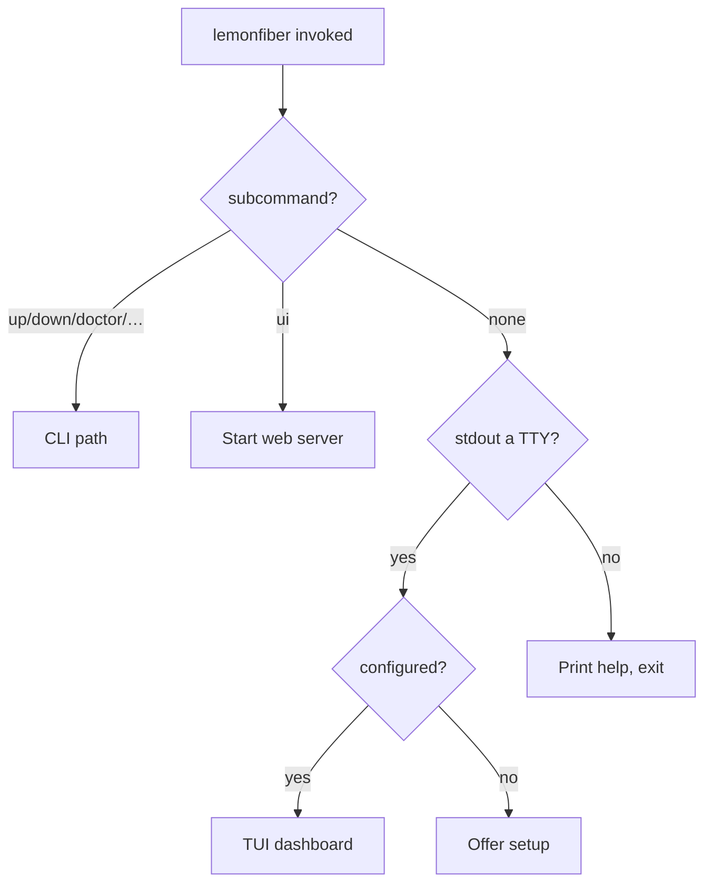

# Repo: `lemonfiber`

**Status:** Accepted

The `lemonfiber` binary — CLI, TUI and web UI over one core. Rust, Hippocratic 3.0.

**Implements:** the operator-facing half of [10-functional](../10-functional/),
under the structure fixed in [20-architecture/component-model](../20-architecture/component-model.md).

---

## What this repo is

One binary, three surfaces, one core. It sets the stack up, runs it, and proves
it's working. It is **not** a general Docker manager
([vision non-goals](../00-overview/vision.md#non-goals)) — its value is that it
knows about *this* stack.

## Layout

```
lemonfiber/
├── Cargo.toml                  workspace
├── crates/
│   ├── lemonfiber/             bin — chooses a surface and runs it
│   │   ├── build.rs            validates submodule schema_version
│   │   ├── src/cli.rs          clap: subcommands, flags
│   │   ├── src/dashboard.rs    ratatui: the dashboard and the log viewer
│   │   ├── src/ui.rs           binds the socket the web surface is served on
│   │   ├── src/main.rs         surface selection
│   │   └── tests/              integration tests
│   ├── lemonfiber-api/         lib — axum: the JSON endpoints, and the frontend served
│   ├── lemonfiber-core/        lib — all logic, no UI
│   ├── lemonfiber-ports/       lib — the boundary and its vocabulary
│   ├── lemonfiber-adapters/    lib — the ports' implementations that reach outside the process
│   ├── lemonfiber-fixtures/    lib — the fakes for those traits
│   ├── lemonfiber-manifest/    lib — stack.toml
│   └── lemonfiber-plugin/      lib — plugin.toml, and the vocabularies a plugin names things from
├── assets/plugins/             git submodule — lemonfiber-plugins, whose default bundle is embedded at build
├── assets/web/                 git submodule — the built web surface, embedded at build
├── contract/                   generated contracts: the web API, the plugin schema and vocabularies
├── reference/                  the generated command reference, error codes and release record
└── .docs/                      repo-local technical docs
```

Crate responsibilities are fixed in
[component-model](../20-architecture/component-model.md#crate-layout); this doc
covers what's specific to building the repo.

## `.docs/` — repo-local documentation

Per the [three-layer model](../40-quality/code-comments.md#the-three-documentation-layers),
`lemonfiber` carries its own `.docs/` tree for Rust-specific technical detail that is
**not** a product decision (those live in this spec) and **not** a code comment.

```
lemonfiber/.docs/
├── 00-index.md
├── architecture/       how subsystems are built — the ports boundary, dispatch,
│                       the engine API, the embedded stack, the error model
└── conventions/        an index pointing at the comment policy, which is canonical in the spec
```

Code links here (`Q-R5`); these pages cite spec requirement IDs. This is the
middle layer that keeps requirement IDs out of code comments (`GOV-R6`) while
still connecting code to the spec.

## Surface selection



This realises [G1-R3](../10-functional/features/g-ux/g1-interface-tiers.md) and
[G1-R4](../10-functional/features/g-ux/g1-interface-tiers.md): bare invocation
opens the TUI at a terminal and prints help when piped, never blocking on stdin.

## Key dependencies

| Crate | Role | Why |
|-------|------|-----|
| `clap` | CLI parsing | Derive; generates help and completions |
| `ratatui` + `crossterm` | TUI | [ADR-0003](../00-overview/decisions/0003-rust-ratatui-for-cli.md); crossterm for real Windows support |
| `axum` | Web server | Minimal, tokio-native; `lemonfiber-api`, and the socket the `lemonfiber` crate binds |
| `bollard` | Docker API | Reads only; only in `lemonfiber-adapters` |
| `tokio` | Async | Shallow — [component-model](../20-architecture/component-model.md#async-model) |
| `reqwest` | Service HTTP | Seed clients |
| `serde` + `toml` | Manifest, config | |
| `etcetera` | Platform paths | XDG / `AppData` / `~/Library`; permissive dependencies throughout |
| `include_dir` | Embed stack + web assets | [The submodule](#the-submodule) |
| `thiserror` | Library errors | `lemonfiber-core` |
| `color-eyre` | Binary errors | The `lemonfiber` crate only |

`unsafe` is denied crate-wide (see [code-standards](../40-quality/code-standards.md)).

## The submodule

`assets/plugins` is a git submodule pinned to a `lemonfiber-plugins` commit, which
holds the default bundle ([bundle.toml](../20-architecture/contracts/bundle.md)).
`crates/lemonfiber-bundled/build.rs`:

1. Fails clearly if the submodule is empty (`git submodule update --init --recursive`).
2. Holds every pinned copy to its pin and to its own recordings.
3. Assembles the stack the bundle declares into one manifest text and fails the
   build where the manifest reader refuses it (`ARCH-R6`).

So an incompatible stack/binary pairing cannot compile, let alone ship.

**The binary carries everything the stack is built from.** The bundle and every pinned
plugin's tree are compiled in, and what lemonfiber writes from them is materialised under
the platform's directories on first run ([configuration on disk](#configuration-on-disk)).
The set of plugins the core trusts as first-party is generated from the bundle's pins,
by id, manifest digest and tree digest, and never written by hand (`ARCH-R300`).
`--stack-dir <path>` points lemonfiber at a stack directory of the operator's own instead,
for development or customisation (`F1-R3`).

- **A first run needs no network and no git.** Download one binary, run it, and the
  stack comes up.
- **Version skew is a compile error.** The build refuses a stack the binary cannot read,
  so an incompatible pairing never reaches a user
  ([versioning](../20-architecture/contracts/versioning.md#where-skew-is-caught)).
- **It is reproducible.** A given release materialises byte-identical files, which makes
  a bug report about them meaningful.
- **What it writes stays the operator's.** Each materialised file is recorded by content,
  and one the operator changed is never overwritten without a diff and confirmation
  (`F1-R4`).

The cost is that a fix to the stack reaches an operator only with a lemonfiber release;
`--stack-dir` lets an urgent case be worked around at once, and the binary grows by the
size of the trees it carries. Fetching the stack on first run would need the network at
the worst moment, before the operator has anything working, add TLS, proxy and
rate-limit failures, and make skew a runtime error. Cloning it would need git as well,
which many Windows machines lack. Shipping the files beside the binary would break the
single-file download every installer relies on, and reading only a path the operator
names would make a zero-configuration first run impossible. This is decided again if
stack changes become frequent enough that tying them to a release hurts.

## Build-time work

| Step | Produces |
|------|----------|
| `build.rs` | Schema validation; embedded stack |
| `cargo build` | The binary |

The app is built in [`lemonfiber-web`](lemonfiber-web.md)'s own CI and tagged
there; this repo carries the result as a pinned submodule and embeds it with
`include_dir!` ([ADR-0012](../00-overview/decisions/0012-web-assets-embedded-at-build-time.md)).
No Node toolchain enters the Rust build or the operator's machine (`ARCH-R19`).

## Configuration on disk

| Path (Linux shown) | Holds |
|--------------------|-------|
| `~/.config/lemonfiber/` | `.env`, expected-state baseline, journal |
| `~/.local/share/lemonfiber/stack/` | Materialised stack files |
| `~/.local/share/lemonfiber/config/` | Per-service config (the `/config` mounts) |
| `~/.local/share/lemonfiber/backups/` | Backup archives |

Resolved via `etcetera`, so macOS and Windows get their conventional
locations. `--stack-dir` overrides the stack path (`F1-R3`).

## Testing posture

Most of `lemonfiber-core` is testable without Docker or a terminal, by design
(`ARCH-R11`). Detail in [testing-strategy](../40-quality/testing-strategy.md); the
load-bearing point:

- **Command construction** is pure → golden-file tested across every form × every
  platform, no daemon.
- **Docker access** is behind a trait → mockable.
- **Platform** is one component → faked, so all four environments run from one
  machine (`ARCH-R35`).

## What lives here vs. in the spec

| Here (`lemonfiber`) | Spec |
|--------------|------|
| How the render loop is built | That it must not block (`B3-R4`) |
| Which crate parses TOML | The manifest contract |
| The exact port-push shell mechanism | That the port must be re-pushed (`C2-R5`) |
| Rust module structure | That core cannot render (`ARCH-R11`) |

Rule of thumb: **what** and **why** are the spec's; **how, in Rust** is this
repo's `.docs/`.

## Related

- [lemonfiber-tui.md](lemonfiber-tui.md) — screen-by-screen TUI spec
- [lemonfiber-reference.md](lemonfiber-reference.md) — every subcommand and flag
- [component-model](../20-architecture/component-model.md) · [platform-matrix](../20-architecture/platform-matrix.md)
- [40-quality](../40-quality/) — how the code is written
